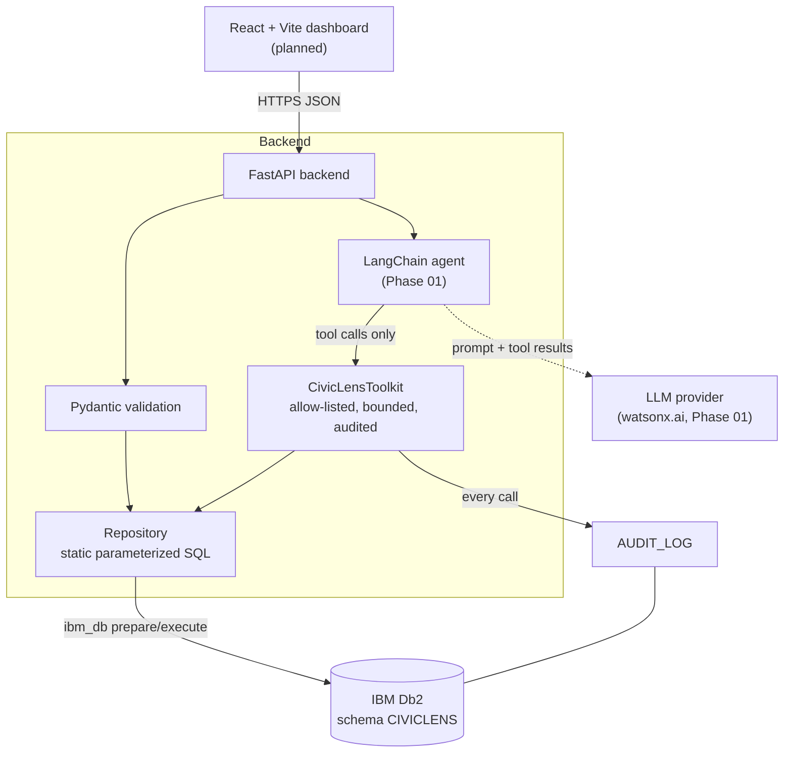

# CivicLens AI: System Architecture

## Overview
CivicLens AI has a FastAPI backend with IBM Db2 as its **only persistent store**. All business data, analytics (duplicate detection, hotspot aggregation) and the audit trail live in Db2. A LangChain agent (Phase 01) investigates questions by calling a small set of typed, audited tools. Each tool wraps one static, parameterized Db2 query. A React dashboard (Phase 01–02) talks only to the API.

## Architecture Diagram



## Component Breakdown
| Layer | Module | Responsibility |
|---|---|---|
| Config | `civiclens/config.py` | Env-driven settings; password is a `SecretStr`; schema name validated as a Db2 identifier |
| Db2 connection | `civiclens/db/connection.py` | `ibm_db` session wrapper: prepare/execute with bound params, transactions, server info, redacted errors |
| Migrations | `civiclens/db/migrate.py`, `schema.sql` | Catalog-checked (`SYSCAT.*`) idempotent DDL |
| Repository | `civiclens/db/repository.py` | All SQL: insert/read/list complaints, duplicate candidates, hotspots, investigations, audit |
| Domain | `civiclens/domain/*` | Pydantic models, geo-cells, haversine, text fingerprint/Jaccard (pure, unit-tested) |
| Agent tools | `civiclens/agent/tools.py` | LangChain `StructuredTool`s with bounded args and audit logging |
| API | `civiclens/api/main.py` | REST endpoints, CORS, 503 on DB unavailability |
| Scripts | `src/backend/scripts/` | migrate, synthetic data generate/seed, Db2 smoke test |

## Data Flow
1. **Ingestion:** `POST /api/complaints` validates the payload, then computes `GEO_CELL` and `TEXT_FINGERPRINT`, then runs `INSERT` via `FINAL TABLE` to get the new id.
2. **Duplicate check:** Db2 filters by category, status, an indexed bounding box and a ±14-day window, computes the exact haversine distance in SQL, and keeps rows within the radius. Python re-ranks them by text similarity. The candidates are returned to the caller.
3. **Hotspots:** a Db2 `GROUP BY GEO_CELL, CATEGORY … HAVING COUNT(*) >= ?` over the requested window.
4. **Investigation (Phase 01):** an investigation row is created, and the agent calls the tools. Each call writes an `AUDIT_LOG` row, and evidence links go to `INVESTIGATION_EVIDENCE`.
5. **Recommendation and review (Phase 01):** the agent can only insert `RECOMMENDATIONS` with status `PROPOSED`. A human reviewer records the decision in `REVIEW_DECISIONS`, and that decision updates the recommendation status.

## IBM Db2 Schema & Storage Design
The full DDL is in [`src/backend/civiclens/db/schema.sql`](src/backend/civiclens/db/schema.sql). Summary:

```text
COMPLAINTS (PK COMPLAINT_ID identity)
  category/status/severity CHECKs, lat/lon DECIMAL(9,6) + CHECK ranges,
  GEO_CELL, TEXT_FINGERPRINT CHAR(64), DUPLICATE_OF -> COMPLAINTS (self FK),
  IS_SYNTHETIC SMALLINT CHECK (0,1), REPORTED_AT, CREATED_AT
  IX (CATEGORY, REPORTED_AT) | IX (GEO_CELL, REPORTED_AT) | IX (TEXT_FINGERPRINT) | IX (STATUS, REPORTED_AT)

INVESTIGATIONS (PK INVESTIGATION_ID) -- status OPEN|RUNNING|PENDING_REVIEW|CLOSED|FAILED
INVESTIGATION_EVIDENCE (PK INVESTIGATION_ID+COMPLAINT_ID, FKs cascade, RELEVANCE 0..1)
RECOMMENDATIONS (PK, FK -> INVESTIGATIONS, CONFIDENCE 0..1, status PROPOSED|APPROVED|REJECTED|NEEDS_INFO)
REVIEW_DECISIONS (PK, FK -> RECOMMENDATIONS, reviewer, decision, comment)
AUDIT_LOG (PK, INVESTIGATION_ID, ACTOR_TYPE USER|AGENT|SYSTEM, ACTION, TOOL_NAME,
           INPUT_JSON, OUTPUT_SUMMARY, SUCCESS)   IX (INVESTIGATION_ID, CREATED_AT)
```

Example: the in-database duplicate distance query (abridged):
```sql
WITH NEARBY AS (
  SELECT COMPLAINT_ID, TITLE, DESCRIPTION, TEXT_FINGERPRINT,
         2 * 6371000 * ASIN(SQRT(
             POWER(SIN(RADIANS(CAST(LATITUDE AS DOUBLE) - CAST(? AS DOUBLE)) / 2), 2)
           + COS(RADIANS(CAST(? AS DOUBLE))) * COS(RADIANS(CAST(LATITUDE AS DOUBLE)))
           * POWER(SIN(RADIANS(CAST(LONGITUDE AS DOUBLE) - CAST(? AS DOUBLE)) / 2), 2))) AS DISTANCE_M
  FROM CIVICLENS.COMPLAINTS
  WHERE CATEGORY = ? AND STATUS <> 'DUPLICATE'
    AND LATITUDE BETWEEN ? AND ? AND LONGITUDE BETWEEN ? AND ?
    AND REPORTED_AT BETWEEN CAST(? AS TIMESTAMP) AND CAST(? AS TIMESTAMP)
    AND COMPLAINT_ID <> ?)
SELECT * FROM NEARBY WHERE DISTANCE_M <= CAST(? AS DOUBLE) ORDER BY DISTANCE_M
```

## Secure Agent Tool Design
| Tool | Db2 operation | Bounds |
|---|---|---|
| `search_complaints` | filtered `SELECT` on `COMPLAINTS` | ≤ 25 rows, ≤ 365-day window, enum-validated category/status |
| `get_complaint` | `SELECT … WHERE COMPLAINT_ID = ?` | id ≥ 1 |
| `find_duplicate_candidates` | haversine CTE (above) | radius ≤ 2000 m, window ≤ 90 days |
| `hotspot_summary` | `GROUP BY GEO_CELL, CATEGORY` | ≤ 25 rows, min_count ≥ 2 |
| `propose_recommendation` *(Phase 01)* | `INSERT` with status forced to `PROPOSED` | evidence ids must exist in the investigation |

Rules:
1. No free-form SQL tool exists, and the LLM output is never executed as SQL.
2. Optional filters are assembled only from constant fragments; every value is a bound parameter.
3. `FETCH FIRST n ROWS` uses a server-side clamped integer, never a model-supplied string.
4. Every call is audited, including failures. Error details are not returned to the model, which prevents schema or driver leakage.
5. Write tools cannot approve. Approval exists only on the human review API.

## Security & Secrets Management
- Credentials are read only from the environment or a gitignored `.env`. `DB2_PASSWORD` is a `SecretStr` with no default, and connection errors are redacted.
- The connection-string builder rejects `;` and `=` in host, database and user values.
- The schema name is validated against `^[A-Z][A-Z0-9_]{0,29}$` before it is substituted into SQL.
- CORS is restricted to configured origins. Authentication and authorization for reviewers are planned for Phase 01.
- Synthetic data is always flagged (`IS_SYNTHETIC = 1`, `[SYNTHETIC]` text marker, `SOURCE = 'SYNTHETIC'`).
